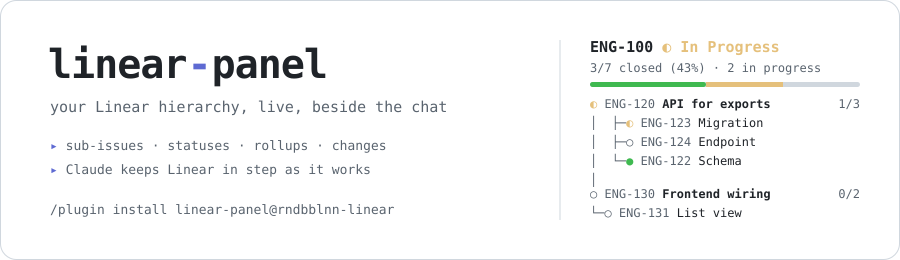
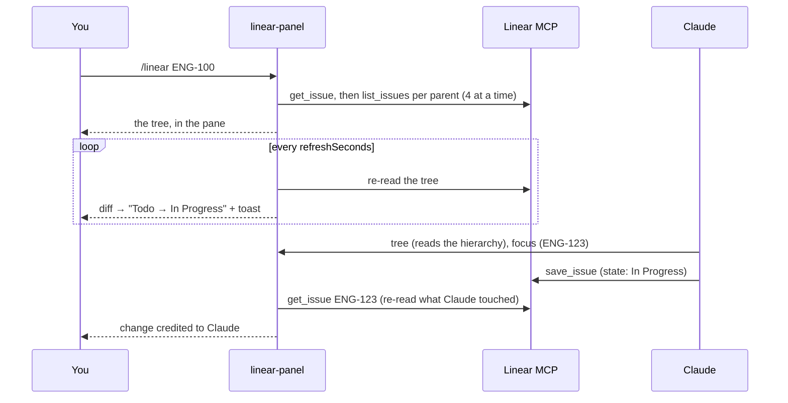

<div align="center">

<picture>
  <source media="(prefers-color-scheme: dark)" srcset="assets/banner-dark.svg">
  <source media="(prefers-color-scheme: light)" srcset="assets/banner-light.svg">
  
</picture>

### Your Linear tree, next to the work.

**A live panel for a Linear parent issue and every sub-issue under it: status, assignee, closed/total rollups and recent changes. Move statuses and comment from the panel, and Claude keeps Linear in step as it works.**

[](LICENSE)
[](https://docs.claude.com/en/docs/claude-code)
[](https://github.com/rndbblnn/cc-mod-linear/tags)


**[Install](#install-30-seconds)** · **[Anatomy](#anatomy-of-the-panel)** · **[How it works](#how-it-works)** · **[Limits](#evidence-and-limits)** · **[FAQ](#faq)**

</div>

<br>

You're implementing a feature split into nine Linear sub-issues. Which ones are done? Which one is Claude on right now? Did it remember to move the last one to In Review? You alt-tab to Linear, again.

**linear-panel** docks that hierarchy beside the chat and keeps it live. It goes through the Linear MCP server you already have connected: no API key, no server.

## Is it for you?

- You work from **Linear parent issues** broken into sub-issues, and want the whole tree in view while you code.
- You let **Claude implement those issues** and want it to move statuses and leave comments without being told every time.
- You want to **change a status or comment** without leaving the terminal.

If you don't use Linear, or your issues are flat, you don't need this.

## Install (30 seconds)

```
/plugin marketplace add rndbblnn/cc-mod-linear
/plugin install linear-panel@rndbblnn-linear
```

Restart Claude Code, then `/linear ENG-123` (an issue id or a Linear URL).

Requires a connected Linear MCP server, which `/mcp` lists as `linear`. If yours has another name, set `mcpServer` in `/config`. In auto mode, allow the read tools first: see the [FAQ](#faq).

## Anatomy of the panel

```
ENG-100 ◐ In Progress                        root · its status
Export reports as CSV                        root title
3/7 closed (43%) · 2 in progress · 12s ago   rollup · last read
━━━━━━━━━━━━━━━━━━━━──────────────────       green done, yellow in progress
▸ Claude on ENG-123 · writing migration      what Claude is working on

├─ ◐ ENG-120 API for exports      1/3 RB     parent: bold, its rollup, assignee
│  ├─ ◐ ENG-123 ▸ Migration           MV     ▸ = Claude's focus
│  ├─ ○ ENG-124 Endpoint                     not started
│  └─ ● ENG-122 Schema                SR     done (dimmed)
│                                            spacer between groups
├─ ○ ENG-130 Frontend wiring      0/2 MG
│  ├─ ○ ENG-131 Form
│  └─ ⊘ ENG-132 Legacy view                  canceled (struck through)
└─ ● ENG-115 Spike                    RB
──────────────────────────────────────
✓ ENG-140 all sub-issues closed · still In Progress     close candidate
2m ago ENG-123 Todo → In Progress (Claude)               who changed what

refresh                                      pinned to the pane's bottom
○ todo  ◐ in progress  ● done  ⊘ canceled    legend
```

- **A real tree**: `├─ └─ │` connectors, ids in one column, counts and assignees on the right edge. Titles are cut to the panel's width, never wrapped.
- **Active work first** among siblings: in progress, then todo, triage, backlog, done, canceled.
- **A legend pinned to the bottom** names the status glyphs the tree uses, in lifecycle order: `◇` triage, `◌` backlog, `○` todo, `◐` in progress, `◐` in review (cyan), `●` done, `⊘` canceled or duplicate. A tree taller than the pane pushes it below the fold.
- **Changes are credited**: a status move shows whether it came from you (the panel), Claude, or someone in Linear. Changes made in Linear also pop a toast.
- **Close candidates**: an open parent whose sub-issues are all closed is listed under the tree.

## Act on an issue

Click a row (or tab to it and press <kbd>enter</kbd>) for its detail and its own sub-tree:

| Key | Action |
| --- | --- |
| <kbd>s</kbd> | Status picker, in the team's workflow order; <kbd>1</kbd>–<kbd>9</kbd> picks |
| <kbd>c</kbd> | Comment (markdown, <kbd>enter</kbd> posts) |
| <kbd>o</kbd> | Open in the browser |
| <kbd>y</kbd> | Copy the link |
| <kbd>t</kbd> | Track this issue as the new root |
| <kbd>r</kbd> | Re-read it from Linear |
| <kbd>b</kbd> | Back to the tree |

## How Claude keeps Linear updated

While a root is tracked (option `instructClaude`, on by default), the system prompt names the root and these rules:

- Before implementing a tracked issue: call `focus`, and move it to **In Progress** if it is in Triage/Backlog/Todo.
- When an MR/PR is opened: move it to **In Review** and attach the link.
- Comment only on notable findings, blockers or scope changes, not routine progress.
- Never Done, Canceled or Duplicate, and never create or re-parent issues, unless asked. When every sub-issue of a parent closes, say so and offer to close it.

The section never contains statuses, so refreshes don't invalidate the prompt cache.

## How it works

One hooks module on Claude Code's mod API. It reads Linear through the engine's own MCP connection (`$.mcp.call`), so it holds no credentials.



| Hook | What the panel does with it |
| --- | --- |
| `session.start` | Registers `/linear` and the two tools, resumes this folder's last root, starts a 1 s tick for polling and the status line |
| `command.run` · `linear` | Tracks a root, shows/hides the pane, refreshes, stops |
| `prompt.compose` | Adds the tracking rules (root id and title only) as a session-scoped section |
| `tool.call` · `tree` | Answers with the hierarchy as indented text, rollups and Claude's focus |
| `tool.call` · `focus` | Records which issue Claude is on; the pane and status line show it |
| `tool.call` · `save_issue` / `save_comment` | Credits Claude's write, then re-reads the touched issue (or the tree, for a new sub-issue) |
| `ui.render` · `Pane` | Draws the tree, or one issue's detail with its actions |

## Small enough to read

| File | Lines | What's in it |
| --- | --: | --- |
| [`hooks/model.ts`](hooks/model.ts) | 337 | Pure logic: MCP result parsing, tree walk, ordering, connectors, rollups, diffs, legend, the prompt section. No I/O, unit-tested |
| [`hooks/register.tsx`](hooks/register.tsx) | ~600 | The hooks, the Linear calls and the JSX the panel draws |
| [`types/index.d.ts`](types/index.d.ts) | 59 | The state contract: `Issue`, `Change`, `Focus`, `TeamStatus` |

Zero runtime dependencies: every import is from Claude Code itself. Network goes only through your Linear MCP server. The only thing persisted is the tracked root per folder (`$.store`); everything else lives in the session.

## Evidence and limits

What's verified, and what isn't:

- ✅ **Tree walk, ordering, connectors, rollups, diffs, legend, status picker, prompt section**: 12 unit and render tests.
- ⚠️ **Auto mode refuses the panel's Linear calls** unless you allow them. The panel calls Linear from a slash command and a timer, outside any model turn, so auto mode's classifier has nothing to judge and refuses. Allow the tools in `permissions.allow` (see the [FAQ](#faq)).
- ⚠️ **Another mod's `prompt.compose` hook can shadow this one.** If a mod that runs first answers without calling `next`, the tracking rules never reach Claude. The panel itself still works.
- ⚠️ **Live-session coverage is thin.** Credited changes and Linear-side toasts are covered by tests only.
- **One `list_issues` call per parent on each full refresh** (4 in parallel), capped at 300 issues and 8 levels. For large trees, raise `refreshSeconds`.
- **Statuses** come from the team's workflow (`list_issue_statuses`), read once per team per session.
- **The mod API is early access** and may change between Claude Code releases.

## Commands and options

| Command | |
| --- | --- |
| `/linear ENG-123` | Track ENG-123 (id or Linear URL) and open the panel |
| `/linear` | Show or hide the panel |
| `/linear refresh` | Re-read the tree now |
| `/linear stop` | Stop tracking |

The tracked root is remembered per folder and resumed next session, without opening the pane unasked.

| Option | Default | |
| --- | --- | --- |
| `mcpServer` | `linear` | The Linear MCP server, as `/mcp` names it |
| `refreshSeconds` | `90` | Full re-read interval. `0` = manual only (`r` or `/linear refresh`) |
| `instructClaude` | `true` | Add the tracking rules to the system prompt |

Set them in `/config`, or in `~/.claude/settings.json`:

```json
{ "pluginConfigs": { "linear-panel": { "options": { "refreshSeconds": 120 } } } }
```

## FAQ

<details>
<summary><b>The panel says "auto mode classifier gave no verdict".</b></summary>
<br>

You're in auto mode, and the panel's Linear calls don't come from a model turn the classifier could judge. Allow the read tools in `~/.claude/settings.json` and restart:

```json
{ "permissions": { "allow": ["mcp__linear__get_issue", "mcp__linear__list_issues", "mcp__linear__list_issue_statuses"] } }
```

To change status and comment from the panel too, add `mcp__linear__save_issue` and `mcp__linear__save_comment`. That also lets Claude make those writes without asking.
</details>

<details>
<summary><b>Does it need a Linear API key?</b></summary>
<br>

No. It uses the Linear MCP server Claude Code is already connected to, with whatever access you granted it.
</details>

<details>
<summary><b>Will Claude close my issues?</b></summary>
<br>

Not unless you ask. On its own, the rules only allow In Progress, In Review and comments; Done, Canceled, Duplicate, new issues and re-parenting need you. Set `instructClaude` to `false` to drop the rules entirely.
</details>

<details>
<summary><b>Does it cost tokens?</b></summary>
<br>

One short, stable system prompt section while a root is tracked (cached with the rest of the prompt), plus whatever `tree` and `focus` calls Claude makes. Polling Linear costs no tokens.
</details>

<details>
<summary><b>My Linear MCP server isn't called <code>linear</code>.</b></summary>
<br>

Set `mcpServer` to the name `/mcp` shows (the part between `mcp__` and `__` in its tool names).
</details>

## Repository layout

```
.claude-plugin/
  plugin.json        manifest + options
  marketplace.json   makes the repo installable with /plugin
assets/              README banners
hooks/
  hooks.json         points Claude Code at register.tsx
  register.tsx       the hooks and the drawing
  model.ts           pure logic
  *.test.ts(x)       claude plugin test
types/index.d.ts     state contract
CLAUDE.md            notes and gotchas for contributors (and their agents)
```

## Develop

```
git clone https://github.com/rndbblnn/cc-mod-linear && cd cc-mod-linear
claude plugin validate .
claude plugin test .
claude --plugin-dir .      # a session with your checkout loaded
```

Issues and PRs welcome. [`CLAUDE.md`](CLAUDE.md) lists the gotchas. Sibling of [subagents-panel](https://github.com/rndbblnn/cc-mod-subagents-panel), same conventions.

<div align="center">
<br>

**If it saved you an alt-tab to Linear, a ⭐ helps others find it.**

MIT © [rndbblnn](https://github.com/rndbblnn)

</div>
